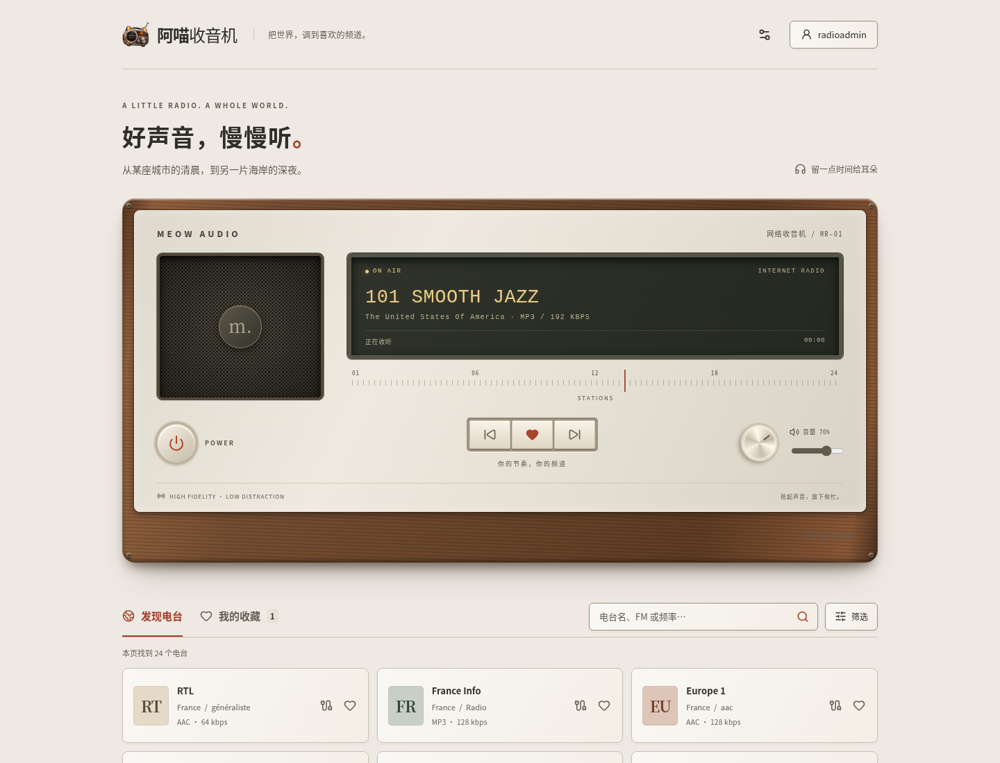
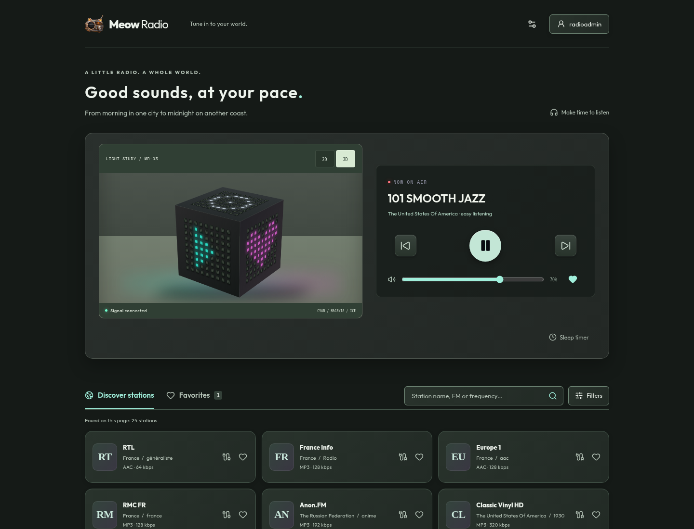
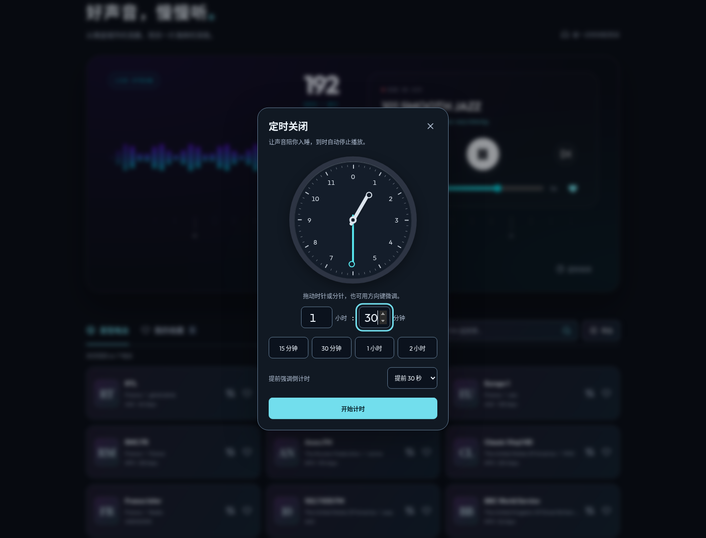
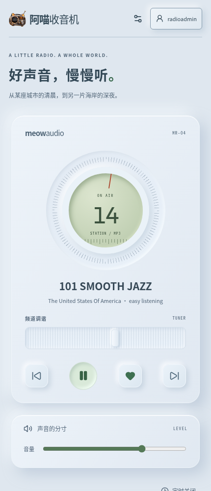
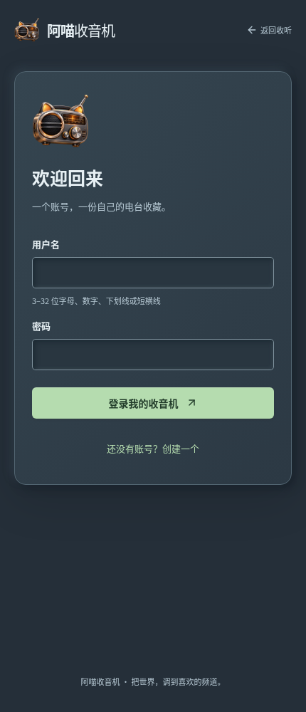
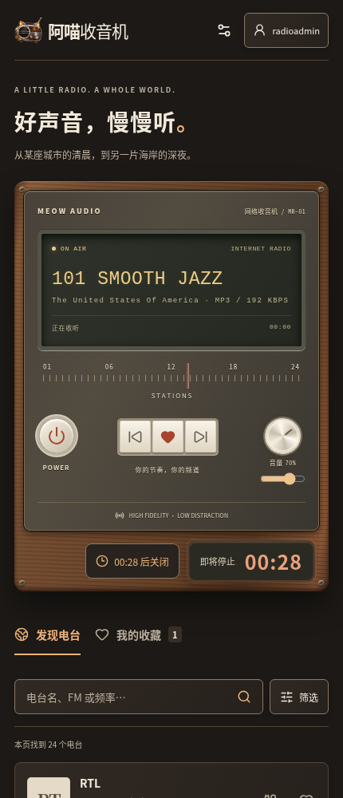

<p align="center"></p>

# 阿喵收音机 · meowRadio

把世界，调到喜欢的频道。Rust 编写的自托管网络收音机，React 界面直接嵌入二进制，使用 SQLite 保存账号与个人收藏。

- **四套主题**：胡桃木拟物收音机、琉璃夜色玻璃播放器、光阵立方 LED 播放器（2D / 3D）、云白拟态圆盘收音机。每套外观均有独立浅色/暗色配色；切换不打断播放，偏好保存在当前浏览器。
- **语言**：简体中文 / English，设置中切换，控件、提示、登录页与筛选面板同步更新。电台名称保留目录原文。
- **定时关闭**：拖动时针、分针选择时长，也可输入数字或使用 15/30/60/120 分钟预设。支持取消、重新设定；换台、切换外观和进入登录页不会重置计时。可设置关闭前 10 秒、30 秒、1 分钟或 5 分钟显示强调倒计时，也可关闭提示。
- **多用户**：独立 `/login` 页面完成用户名/密码登录与注册，独立收藏；Argon2id 密码、HttpOnly 会话 Cookie、过期与退出撤销。
- **首次初始化**：环境变量创建首个管理员，或首次访问时使用设置向导。初始化只运行一次，不会因重启重置密码。
- **世界电台**：基于 `radiobrowser` crate 和 Radio Browser API，支持名称、类型、国家筛选及分页。首页只保留筛选入口，点击后可按国家、语言、节目类型、排序及音质组合浏览，无需关键词。中文输入法选词完成后再搜索，支持 Enter 立即搜索和空结果恢复。`FM 104.2` / 全角频率写法会转换为电台名称中的频率关键词。
- **收听**：播放、暂停、换台、音量；HLS 按需加载；HTTP/HTTPS 出站代理和可选的服务端音频中转。
- **交付**：Linux / macOS / Windows 二进制，amd64/arm64 Docker，GitHub Actions 自动测试和发布。

## 界面

四套外观均支持浅色/暗色；语言与颜色在设置中切换，首页只保留搜索和筛选入口。

### PC 端

| 胡桃木首页 | 英文暗色界面 | 时钟定时器 |
| --- | --- | --- |
|  |  |  |

### 移动端

| 云白拟态首页 | 独立登录页 | 关闭前倒计时 |
| --- | --- | --- |
|  |  |  |

## Docker

```sh
docker run -d --name meowradio \
  -p 3000:3000 \
  -v meowradio-data:/data \
  ghcr.io/ca-x/meowradio:latest
```

打开 `http://localhost:3000`，按向导创建管理员。也可在仓库中运行 `docker compose up -d --build` 从源码构建。

自动初始化示例（生产环境请用部署平台的 secret 注入密码）：

```sh
docker run -d --name meowradio \
  -p 3000:3000 -v meowradio-data:/data \
  -e MEOW_INIT_USERNAME=admin \
  -e MEOW_INIT_PASSWORD \
  ghcr.io/ca-x/meowradio:latest
```

运行前在当前 shell 中设置 `MEOW_INIT_PASSWORD`。两项都未设置时启用向导；首次启动仅设置其中一项会报错退出。安装已初始化后忽略这两个变量。Compose 中需要取消 `compose.yaml` 对应两行的注释。

## 二进制

从 [Releases](https://github.com/ca-x/meowRadio/releases) 下载对应平台文件，验证 `SHA256SUMS` 后解压运行：

```sh
./meowradio
# 或环境变量初始化
MEOW_INIT_USERNAME=admin MEOW_INIT_PASSWORD="$RADIO_ADMIN_PASSWORD" ./meowradio
```

无需 Node.js 或外部数据库。默认监听 `0.0.0.0:3000`，自动创建 `data/meowradio.db`。Windows 使用 `meowradio.exe`；Linux GNU 二进制面向 Ubuntu 24.04 / glibc 2.39 或更高版本，旧发行版建议 Docker。`--version` 显示版本。

## 浏览与筛选

在首页点击“筛选”打开面板。国家/地区、语言、节目类型和排序在面板中选择；编码和最低码率放在“音频格式与音质”折叠区。点击“应用筛选”更新列表，关闭面板会丢弃未应用的修改。入口仅显示已启用条件数量，首页不铺开筛选项。目录选项按需加载，括号中的数量是整个目录的收录量，并非组合筛选结果总数。

## 定时关闭

点击播放器旁的时钟入口，拖动两根指针设置小时和分钟；也支持键盘方向键、数字输入及快捷预设。点击“开始计时”后按实际截止时间停止播放，重新设置会替换上次计时。

“关闭前倒计时”决定何时显示更醒目的提示：关闭、10 秒、30 秒、1 分钟、5 分钟。提示跟随当前材质与配色，数字保持稳定，仅光晕有轻微呼吸效果；系统启用减少动态效果时保持静态。取消定时或计时结束后提示清除。提前提示偏好会保存，正在运行的定时仅属于当前页面会话，刷新/关闭页面会结束该会话；设备休眠时浏览器无法执行计时，恢复执行后会按已过的截止时间立即停止。

## 配置

程序从进程环境读取配置，**不会自动加载 `.env`**。`.env.example` 是示例；Compose 自动读取 `.env`，但仅将 `compose.yaml` 声明的项目传给容器。

| 环境变量 | 默认值 | 用途 |
| --- | --- | --- |
| `MEOW_LISTEN` | `0.0.0.0:3000` | 监听地址 |
| `MEOW_DATABASE` | `data/meowradio.db` | SQLite 文件，Docker 默认 `/data/meowradio.db` |
| `MEOW_INIT_USERNAME` | 未设置 | 首次初始化管理员用户名 |
| `MEOW_INIT_PASSWORD` | 未设置 | 首次初始化管理员密码，10–128 字节 |
| `MEOW_REGISTRATION` | `true` | 是否允许其他用户注册 |
| `MEOW_SECURE_COOKIE` | `false` | HTTPS 部署设为 `true` |
| `MEOW_RELAY` | `true` | 是否允许登录用户使用音频中转 |
| `MEOW_PROXY` | 未设置 | 出站 `http://`、`https://`、`socks5://` 代理，可含认证 |
| `MEOW_CATALOG_URL` | 公共 Radio Browser 服务 | 自托管 API 根地址，不包含 `/json` |
| `RUST_LOG` | `meowradio=info,tower_http=info` | 日志级别 |

首次初始化前应先在可信网络完成向导，或直接用环境变量设置管理员。对外部署使用 HTTPS 反向代理并开启 Secure Cookie。修改环境配置后重启服务。界面语言、配色、外观、音量及倒计时提示提前量保存在当前浏览器，不会修改其他账号的服务端数据。

### 代理和收听方式

点击页面右上角设置图标，在“外观与连接”中选择主题和收听方式，并用测试按钮检查连接。测试仅请求固定的外网 Radio Browser 状态接口，返回是否成功及耗时，不会返回代理凭据。

电台列表中，点击电台名称直接播放；点击电台旁的代理图标则经服务端收听（需要登录）。配置 `MEOW_PROXY` 后使用该出站代理，否则通过服务器自身网络中转。

- **目录代理**：设置 `MEOW_PROXY` 后，搜索、频道解析和收听计数通过代理请求。代理地址和凭据不会下发到浏览器。
- **浏览器直连**：音频由浏览器直接请求，不使用服务端代理；支持普通流和 HLS。电台须支持当前浏览器的编码；HLS 还需电台允许跨域请求。
- **服务端中转**：需要登录，支持连续音频流；不支持 HLS 播放列表。HTTPS 页面可用它收听 HTTP 电台。
- **中转安全边界**：只接受 Radio Browser 电台 UUID，每次重定向重新检查公共 IP 并固定解析结果。支持端口 80、443、8000–9999，最多 32 个并发中转。
- **配置代理时的限制**：为避免代理端二次 DNS 解析绕过私网限制，仅中转 HTTP 音源，HTTPS 音源请使用直连。无代理时支持 HTTP 和 HTTPS 中转。`socks5h` 未启用。

Radio Browser 是社区维护目录，部分电台可能离线、地域受限或编码不被浏览器支持。页面会显示连接失败和重试入口。琉璃波形和 LED 是随播放状态变化的装饰，不代表真实音频频谱，也不显示虚构 FM 频率。

### 数据和备份

SQLite 启用 WAL、外键和自动迁移。备份可停止服务后复制数据库；在线备份应使用 SQLite `.backup`，不要只复制正在写入的 `.db` 文件。数据卷应仅由服务用户访问。当前定位为单实例自托管服务。登录限流使用连接来源 IP，每分钟 12 次；反向代理后的用户会共享代理 IP 的额度。

## 本地开发

Rust 1.94+、Node.js 24+，npm。仓库锁定 Rust 1.94.0。

```sh
npm --prefix web ci --ignore-scripts
npm --prefix web run build
cargo run
```

需要热更新时另开终端运行 `npm --prefix web run dev`，Vite 默认将 `/api` 转发到 `127.0.0.1:3000`。

```sh
cargo fmt --check
cargo clippy --locked --all-targets -- -D warnings
cargo test --locked
npm --prefix web test
npm --prefix web run build
npm --prefix web audit --audit-level=high
npm --prefix web audit signatures --omit=dev
cargo audit
```

前端构建完成后才能编译 Rust，release 模式将 `web/dist` 和字体授权文件完整嵌入二进制。HLS 播放器按需加载，不影响普通电台的首屏资源。

## 发布

CI 检查格式、Clippy、前后端测试、依赖审计、嵌入式二进制及非 root Docker 启动。推送与 `Cargo.toml` 版本一致的 `v*` 标签触发 Release：

```sh
git tag v0.1.1
git push origin v0.1.1
```

所有验证通过后，分别构建 Linux amd64/arm64、macOS amd64/arm64、Windows amd64，上传压缩包和 SHA256SUMS，并发布 `ghcr.io/ca-x/meowradio:<tag>`。正式版本同时更新 `latest`；预发布不覆盖 `latest`。本项目 GHCR 镜像已验证允许匿名拉取。仅需仓库内置 `GITHUB_TOKEN` 的 contents/packages 写权限。

## API

所有修改请求需 `X-Meow-Request: 1`；JSON 请求体限制 8 KiB。浏览器 Cookie 会话不使用 localStorage token。

| 路径 | 方法 | 说明 |
| --- | --- | --- |
| `/api/health` | GET | 服务及数据库健康 |
| `/api/setup` | GET / POST | 初始化状态 / 创建首个管理员 |
| `/api/auth/register` | POST | 注册 `{username,password}` |
| `/api/auth/login` | POST | 登录 `{username,password}` |
| `/api/auth/logout` | POST | 撤销当前会话 |
| `/api/auth/me` | GET | 当前账号 |
| `/api/stations` | GET | `q`、`tag`、`country`、`language`、`sort`、`codec`、`bitrate_min`、`offset`，24 条/页；关键词可为空 |
| `/api/directory` | GET | 国家、语言和常见类型目录，缓存一小时 |
| `/api/proxy/test` | POST | 登录用户测试服务端代理/直连到外网的联通性 |
| `/api/favorites` | GET | 当前用户的收藏 |
| `/api/favorites/{uuid}` | PUT / DELETE | 收藏 / 取消收藏 |
| `/api/stream/{uuid}` | GET | 登录用户音频中转 |
| `/api/settings` | GET | 非敏感部署状态 |

## 来源与授权

项目 MIT。API 行为参考 `radiobrowser-api-rust`，嵌入式前端和交付流程参考 [ca-x/raindrop](https://github.com/ca-x/raindrop)。

`radiobrowser` 0.6.1 的旧 HTTP/TLS/DNS 依赖存在已知安全问题，因此本仓库保留上游源码和 API，使用本地安全补丁更新依赖；详情见 [PATCHES.md](vendor/radiobrowser/PATCHES.md)。`cargo audit` 唯一忽略项是未编译、未分发的 SQLx MySQL 可选 RSA 依赖，依据及复查时间在 `.cargo/audit.toml`。

琉璃夜色依据用户提供的玻璃播放器示例实现。光阵立方参考用户提供的 CSS LED Challenge：原作 [Ben Evans](https://codepen.io/editor/ivorjetski/pen/01a07dcf-a1e8-7ab6-aea1-aa98135803b3)，fork [Agustin Capeletto](https://bsky.app/profile/lowpoly.gg)；本项目将其视觉方向重新实现为作用域隔离的 React/CSS 播放器。字体 Outfit、Space Mono 使用 SIL Open Font License，授权随前端嵌入 `/licenses/`。

云白拟态的视觉参考：[Radio Player App — Neumorphic concept](https://dribbble.com/shots/11629433-Radio-Player-App-Neumorphic-concept)，Oleksandr Plyuto for heartbeat。圆盘、浅绿显示窗和冰蓝白软阴影由 CSS 重新实现，调谐和音量控件连接实际功能；未使用原作图片或品牌标志。

应用 Logo 由用户通过 [Issue #1](https://github.com/ca-x/meowRadio/issues/1) 提供，原图保存于 `assets/brand/logo-original.png`。页面 Logo、favicon 和主屏幕图标均由该原图缩放生成。
